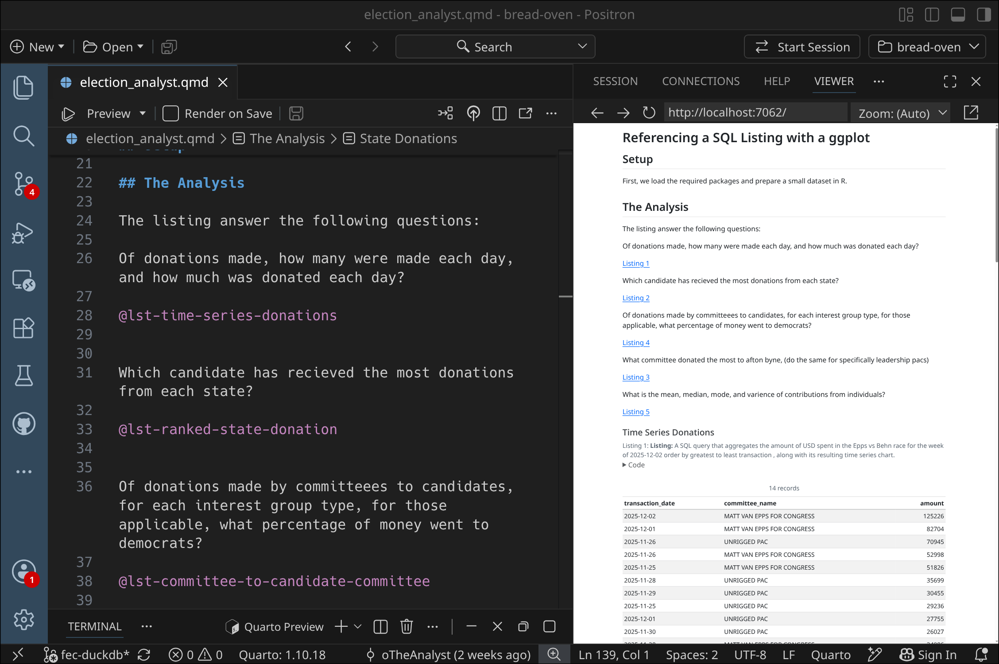
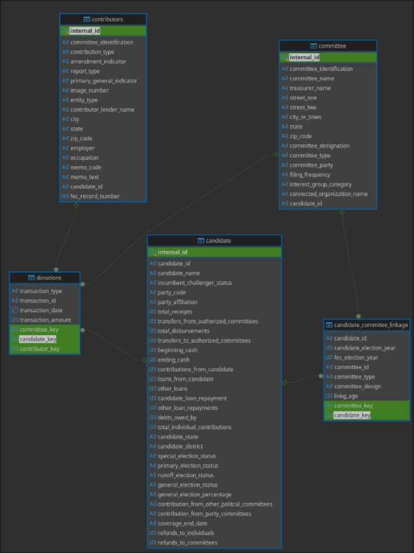

# Fec-Duckdb: The Reproducible Database and Data Analysis Tool Kit

This is a repo for analyzing the Fec database, it is a fully modeled star schema on an olap database for extremely fast read queries. Nix caches the data so the database is reproducible to rebuild the database simply run:

```bash
rm database.db

nix-develop .

```

Whenever you enter the shell, there is a check that runs to see if the database is present in the repositories directory. This allows for simple way to refresh the database.

### Requirements
Nixpkgs or Nixos installation.

30 gigs of free space.


### Install Nix for Linux via the recommended multi-user installation:

Multi-user installation (recommended)
```bash
curl --proto '=https' --tlsv1.2 -L https://nixos.org/nix/install | sh -s -- --daemon
```

We recommend the multi-user install if you are on Linux running systemd, with SELinux disabled and you can authenticate with sudo.


Single-user installation

### Install Nix via the Single-user Installation:

```bash
curl --proto '=https' --tlsv1.2 -L https://nixos.org/nix/install | sh -s -- --no-daemon

```

Above command will perform a single-user installation of Nix, meaning that nix is owned by the invoking user. You should run this under your usual user account, not as root. The script will invoke sudo to create /nix if it doesn’t already exist.

if you have macos or wsl follow the Instructions here:
https://nixos.org/download/

## To run this Project for the Shell and Database 

To get just the the basic tools and the shell run: **(15 to 20 minute install)**
```bash
nix develop  github:oTheAnalyst/bakey-wakey

```

To get the full suit which contains quarto db connection and positron run: **(This can take up to hour)**

```bash
nix develop  github:oTheAnalyst/bakey-wakey#full-shell

```

## (Recommended) For the full repository 


This is the Partial Setup to just run the SQL based analysis: **(15 to 20 minute install)**
```nix
git clone git@github.com:oTheAnalyst/bread-oven.git

cd bread-oven

nix develop .

```

The Full Setup to with R and Python Included: **(This can take up to hour)**
```nix
git clone git@github.com:oTheAnalyst/bread-oven.git

cd bread-oven

nix develop .#full-shell

```



The full-shell provides quarto and Rduckdb which lets you render the qmd file and view the HTML in panes that are side by side.


## The ERD


 This database is built using a star schema on a type 1 SCD type.

 donations <-- fact_table
 candidate_committee_linkage <-- bridge table


## The File Structure 

The main directory of concern for user is the analysis folder, the rest is simply the build instructions.
```
.
├── election_analyst_files
│   ├── figure-html
│   └── libs
│       ├── bootstrap
│       ├── clipboard
│       └── quarto-html
│           └── tabsets
└── sql
    └── ddb_sql
        ├── analysis << this contains the relevant files is usuage of the database
        ├── intemediate
        └── mart
```

